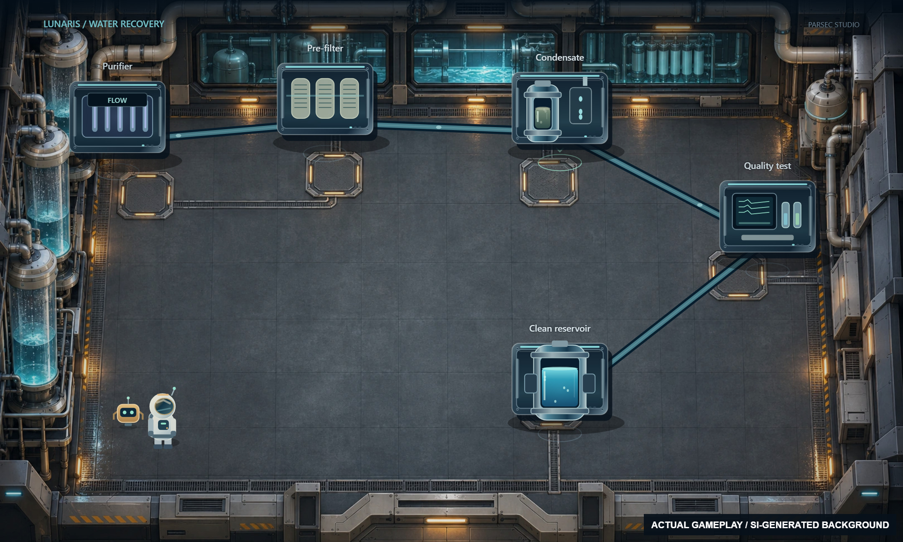
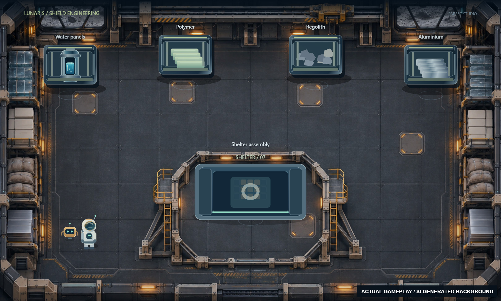

# LUNARIS - The Last Signal

### A lunar science adventure by Parsec Studio

**[Play online](https://parsec.kz/lunaris/) · [View presentation (PDF, 7 slides)](demo/LUNARIS-Demo.pdf) · [Download PDF](https://github.com/isazhannnn/LUNARIS/raw/refs/heads/main/demo/LUNARIS-Demo.pdf)**

**Project team:** Meiirzhan Issa and Zhasulan Zholdas · **Parsec Studio**  
**Release:** 14 November 2026 · **Languages:** English / Russian · **Controls:** Keyboard / Touch

## The project

LUNARIS is an educational browser game where school students learn to keep a lunar outpost alive. The crew has evacuated. Alex remains at the damaged station with PIX, a helper robot, limited resources and a broken connection to Earth. Restoring the outpost requires decisions about power, air, water, food and protection.

Created for [Build a Junior Astronaut Mission Trainer](https://www.spaceappschallenge.org/2026/challenges/junior-astronaut-mission-trainer/), the game connects scientific ideas to actions and their consequences. Players walk between machines, carry materials, operate equipment, observe the result and explain their choices.

The live game is available at **[https://parsec.kz/lunaris/](https://parsec.kz/lunaris/)**. It opens at the main menu and runs in a browser without registration or installation. The story and science expeditions are available from that menu.

## Project presentation

The **[seven-slide English presentation](demo/LUNARIS-Demo.pdf)** introduces the learning approach, demonstrates all four expeditions with actual gameplay captures, and presents the scientific references and team. The PDF is included in this repository and can be viewed or downloaded directly.

## Four science expeditions

| Expedition | Player activity | Learning focus |
| --- | --- | --- |
| Water Recovery | Carry water through five stations; balance two valves; test before storage. | Process order and constrained flow. |
| Storm Shelter | Carry two materials and fit panels over exposed sections. | Mass/protection trade-offs and geometry. |
| Earth Link | Calculate round-trip time, tune frequency and phase, and wait for a reply. | Finite signal speed and calibration. |
| Ice Crater | Prepare and drive a rover, drill for ice, and return with energy left. | Route planning, heat and energy budgets. |

The story campaign connects station systems and resource choices. PIX supplies contextual guidance. Selected conditions and questions vary between launches; completing a physical task leads to an explanation and knowledge check. Badges and progress are stored in the browser.

## Scientific basis

The project draws on [nine NASA resources](docs/NASA_SOURCES.md) covering life support, plants in space, radiation hazards, shielding, signal travel time, lunar ice and a historical DONKI example. These resources inform the educational explanations. The game uses simplified teaching models and does not provide live telemetry, engineering operating procedures or a space-weather forecast. Classroom learning outcomes have not yet been formally evaluated.

## Team and implementation

**Parsec Studio created and directed LUNARIS.** Project team: **Meiirzhan Issa** and **Zhasulan Zholdas**. The team defined the concept, educational focus, story requirements and final creative decisions.

The game uses HTML, CSS, JavaScript, Canvas 2D, Web Audio and browser local storage. It supports keyboard and touch controls, English and Russian, and an offline HTML edition. Gameplay and PIX run locally without an external AI model.

Tool assistance and generated visual assets are identified in [the project acknowledgements](docs/AI_DISCLOSURE.md), [artwork provenance](docs/ARTWORK.md), [asset manifest](docs/ASSET_MANIFEST.json) and [structured metadata](PROJECT_METADATA.json). Generated imagery carries visible marks. [Other references](docs/OTHER_REFERENCES.md) are documented separately.

## Project materials

- [Live browser game](https://parsec.kz/lunaris/)
- [Presentation PDF](demo/LUNARIS-Demo.pdf)
- [Detailed project overview](docs/PROJECT_OVERVIEW.md)
- [NASA resources](docs/NASA_SOURCES.md)
- [Team credits](AUTHORS.md)
- [Development and validation](docs/DEVELOPMENT.md)

[Русское описание](README.ru.md)
