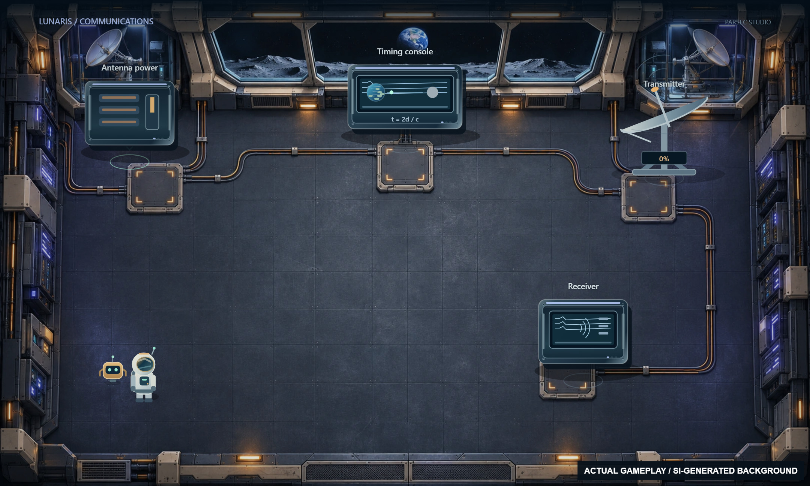
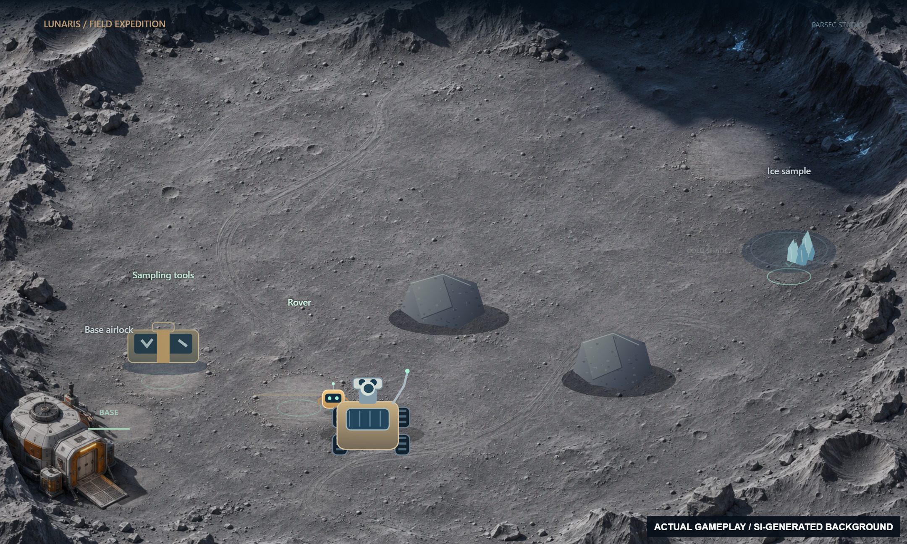

# LUNARIS - The Last Signal

### A lunar science adventure by Parsec Studio

**Project team: Meiirzhan Issa and Zhasulan Zholdas**

**Release:** 14 November 2026 · **Languages:** English / Russian · **Controls:** Keyboard / Touch

| Explore the project | Public link |
| --- | --- |
| **1. Play the game** | **[Open LUNARIS on parsec.kz](https://parsec.kz/lunaris/)** |
| **2. View the presentation** | **[Open the 7-slide PDF](demo/LUNARIS-Demo.pdf)** · [Download PDF](https://github.com/isazhannnn/LUNARIS/raw/refs/heads/main/demo/LUNARIS-Demo.pdf) |
| **3. Read about the project** | **[Project brief](docs/PROJECT_OVERVIEW.md)** · [Evidence for its strengths](docs/PROJECT_STRENGTHS.md) |

The game opens at its main menu. The presentation includes actual gameplay from all four science expeditions. Both are publicly accessible without an account.

## The project

LUNARIS is an educational browser game for school students. The crew has evacuated a damaged lunar outpost. Alex remains with PIX, a helper robot, limited resources and a broken connection to Earth. Restoring the outpost requires decisions about power, air, water, food and protection.

Created for [Build a Junior Astronaut Mission Trainer](https://www.spaceappschallenge.org/2026/challenges/junior-astronaut-mission-trainer/), LUNARIS connects scientific ideas to actions and their consequences. Players walk between machines, carry materials, operate equipment, observe the result and explain their choices.

## Why LUNARIS stands out

- **Scientific reasoning becomes a player action.** Water treatment, shielding, communication and rover energy each have a distinct playable task, followed by an explanation and a knowledge check.
- **Decisions have a visible purpose.** A rover must bring its sample back; shelter materials must satisfy both mass and protection limits; recovered water must be tested before storage.
- **Practice can continue after one run.** Selected layouts, budgets, distances, sample positions and questions vary between launches.
- **The game is easy to try.** Browser play, English and Russian, keyboard and touch controls, and an offline HTML edition support different devices and learners.
- **The work can be examined.** Nine NASA resources are mapped to their educational uses. Public source code and automated mission checks make the implementation reviewable.

[Project strengths and supporting evidence](docs/PROJECT_STRENGTHS.md)

## Four science expeditions

| Expedition | Player activity | Learning focus |
| --- | --- | --- |
| Water Recovery | Carry water through five stations; balance two valves; test before storage. | Process order and constrained flow. |
| Storm Shelter | Carry two materials and fit panels over exposed sections. | Mass/protection trade-offs and geometry. |
| Earth Link | Calculate round-trip time, tune frequency and phase, and wait for a reply. | Finite signal speed and calibration. |
| Ice Crater | Prepare and drive a rover, drill for ice, and return with energy left. | Route planning, heat and energy budgets. |

The story campaign connects station systems and resource choices. PIX supplies contextual guidance. Completing an expedition leads to a scientific explanation and a knowledge check. Badges and progress are stored in the browser.

## Team and original concept

LUNARIS was conceived and created by **Parsec Studio**, the team of **Meiirzhan Issa** and **Zhasulan Zholdas**. Our original contribution is the way we connect a story about a stranded lunar engineer with practical science missions: players move through the outpost, operate equipment, compare constraints and explain their decisions. The team defined the core concept, educational goals, story requirements and gameplay direction, and made the final creative decisions. AI tools supported specific development tasks; project authorship and direction belong to our team.

The implementation uses HTML, CSS, JavaScript, Canvas 2D, Web Audio and browser local storage. Gameplay and PIX run locally without an external AI model.

## Scientific basis and acknowledgements

The project draws on [nine NASA resources](docs/NASA_SOURCES.md) covering life support, plants in space, radiation hazards, shielding, signal travel time, lunar ice and a historical DONKI example. These resources inform the educational explanations. Numerical models are simplified teaching tools. Classroom learning outcomes have not yet been formally evaluated.

Tool assistance is documented in [the project acknowledgements](docs/AI_DISCLOSURE.md) and [structured metadata](PROJECT_METADATA.json). Generated imagery carries visible marks and is identified in [artwork provenance](docs/ARTWORK.md) and the [asset manifest](docs/ASSET_MANIFEST.json). [Other references](docs/OTHER_REFERENCES.md) are listed separately.

## Actual gameplay

View screenshots from all four expeditions

### Water Recovery

### Storm Shelter

### Earth Link

### Ice Crater

## Repository guide

| Material | Location |
| --- | --- |
| Seven-slide presentation | [demo/LUNARIS-Demo.pdf](demo/LUNARIS-Demo.pdf) |
| Full project description | [docs/PROJECT_OVERVIEW.md](docs/PROJECT_OVERVIEW.md) |
| Scientific sources | [docs/NASA_SOURCES.md](docs/NASA_SOURCES.md) |
| Team credits | [AUTHORS.md](AUTHORS.md) |
| Source edition | [index.html](index.html), [js/](js/), [css/](css/) |
| Self-contained offline game | [LUNARIS-Play.html](LUNARIS-Play.html) |
| Reproducible checks | [tests/](tests/) · [Development and validation](docs/DEVELOPMENT.md) |

[Русское описание](README.ru.md)
