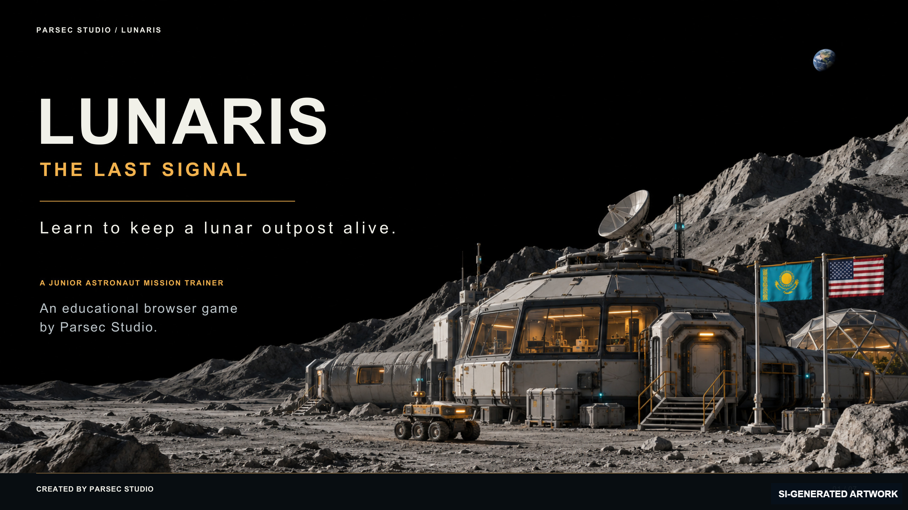

# LUNARIS - The Last Signal

**Created by Parsec Studio**  
**Project team: Meiirzhan Issa and Zhasulan Zholdas**  
Release date: **14 November 2026**



A browser game where school students learn to keep a lunar outpost alive. Control Alex, work with PIX, repair equipment and balance power, air, water, food and protection.

Built for [Build a Junior Astronaut Mission Trainer](https://www.spaceappschallenge.org/2026/challenges/junior-astronaut-mission-trainer/).

## Play

1. Download this repository with **Code > Download ZIP** and extract it.
2. Open **LUNARIS-Play.html** in a desktop browser. Its code, styles and marked artwork are embedded, so it also works offline.
3. Choose a mission. The story campaign is available from the menu or `#story`.

To run the source edition, start `python -m http.server 8000` in the repository and open `http://localhost:8000/`. A hosted copy works on phones. No account, API key, database or dependency installation is needed to play.

The submission edition starts in English and also offers Russian. Starting play requests fullscreen and landscape mode on supported phones; when the browser declines, rotate the device manually.

## Four playable expeditions

| Mission | What the player does | Learning focus |
| --- | --- | --- |
| Water Recovery | Carry water through five stations; set two valves; test before storage. | Process order and constrained flow. |
| Storm Shelter | Carry two materials and fit panels over exposed sections. | Mass/protection trade-offs and geometry. |
| Earth Link | Calculate round-trip time, tune frequency and phase, and wait for a reply. | Finite signal speed and calibration. |
| Ice Crater | Prepare and drive a rover, drill for ice, and return with energy left. | Route planning, heat and energy budgets. |


The story campaign connects station systems and resource choices. PIX supplies contextual guidance. Conditions and questions vary between launches; completing a physical task leads to a science explanation and knowledge check. Badges and progress are stored in the browser.

## Controls

WASD or arrow keys move the hero; E interacts with nearby equipment. Tap/click navigation and a touch joystick support phones. The controls also drive the rover after boarding. The in-game help explains other shortcuts.

## NASA resources and model limits

The game uses NASA resources on ECLSS, plants in space, radiation hazards, shielding, light-travel time, lunar ice and a historical DONKI example. [All nine resources and their use](docs/NASA_SOURCES.md) are documented. This is educational reference use, not a live NASA API integration.

Resources, material scores, compressed time, hazard cycles and routes are simplified teaching models. They are not engineering operating procedures, real radiation-dose estimates or a space-weather forecast. Classroom learning outcomes have not yet been formally evaluated.

## Team and tools

Parsec Studio created and directed LUNARIS. The team defined the concept, learning focus, story requirements and final creative decisions. ChatGPT supported parts of implementation, explanatory writing, testing and debugging; image-generation tools produced fictional backgrounds and cover artwork. Visible marks identify generated visuals in this submission edition. See [tool assistance](docs/AI_DISCLOSURE.md), [asset provenance](docs/ARTWORK.md), [asset manifest](docs/ASSET_MANIFEST.json) and [structured metadata](PROJECT_METADATA.json).

Gameplay and PIX run locally without an external AI model. Audio consists of procedural Web Audio effects; there is no generated voice or model-based music service. [Other tools and references](docs/OTHER_REFERENCES.md) are listed separately.

## Source layout

```text
index.html                Browser source entry
LUNARIS-Play.html          Self-contained offline release
js/                       Simulation, navigation, rendering, UI and translations
css/                      Responsive styles
assets/academy/           Four visibly marked SVG environment assets
assets/brand/             Signal L vector logo and favicon
docs/                     NASA references, provenance and screenshots
submission/               Ready-to-copy project fields and resource tables
demo/                     Seven-slide English demo
tests/                    Model, build and browser checks
tools/                    Standard-library build scripts
PROJECT_METADATA.json     Authorship, release and SI acknowledgements
```

## Build and checks

Run `python tools/build_standalone.py` for the offline file and `python tools/prepare_static.py` for `dist/`. Development checks use Node.js and Python; the browser runtime does not need them. Run `node tests/boot.test.cjs`, `node tests/v6-challenges.test.cjs`, `python tests/build_assets_test.py` and `python tools/validate_repo.py`. Additional story, navigation, hazard and playable-mission tests are in `tests/`.

## Space Apps submission

Use **https://github.com/isazhannnn/LUNARIS** as the public final-project link. [Ready-to-copy form fields](submission/PROJECT_FORM.en.txt) include the summary, detailed description, SI explanation and every resource URL. Add your public demo URL to the form yourself. A seven-slide English PDF is included in `demo/`; you can use another qualifying demo if you prefer.

Public links must open without a login or permission request. Submit through the Space Apps team Project page; uploading to GitHub alone does not submit the entry. [Official submission guide](https://www.spaceappschallenge.org/resources/project-submission-guide/).
