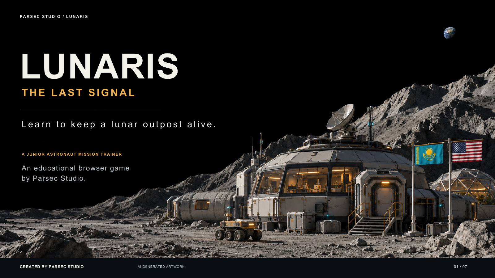

# LUNARIS — Последний сигнал

### Научное приключение на Луне от Parsec Studio

**Команда проекта: Meiirzhan Issa и Zhasulan Zholdas**

**Релиз:** 14 ноября 2026 года · **Языки:** русский / английский · **Управление:** клавиатура / сенсорное

## О проекте

LUNARIS — обучающая браузерная игра для школьников. После эвакуации экипажа Алекс остаётся на повреждённой лунной станции с роботом PIX, ограниченными запасами и потерянной связью с Землёй. Чтобы восстановить базу, игрок принимает решения об энергии, воздухе, воде, питании и защите.

Проект создан для задачи [Build a Junior Astronaut Mission Trainer](https://www.spaceappschallenge.org/2026/challenges/junior-astronaut-mission-trainer/). Научные принципы связаны с действиями и их последствиями: герой ходит между установками, переносит материалы, управляет оборудованием, наблюдает результат и объясняет свой выбор.

**[Играть на сайте](https://parsec.kz/lunaris/) · [Посмотреть презентацию — 7 слайдов](demo/LUNARIS-Demo.pdf) · [Скачать PDF](https://github.com/isazhannnn/LUNARIS/raw/refs/heads/main/demo/LUNARIS-Demo.pdf)**

[Подробное описание проекта](docs/PROJECT_OVERVIEW.md) · [Сильные стороны и подтверждения](docs/PROJECT_STRENGTHS.md)

Сайт открывается с главного меню. Презентация показывает реальные кадры всех четырёх научных экспедиций. Игра и PDF доступны без регистрации.

## Сильные стороны LUNARIS

- **Научную задачу нужно выполнить в игровом мире.** Восстановление воды, защита от радиации, связь и поиск льда имеют разные механики, объяснения и проверочные вопросы.
- **Решения влияют на результат миссии.** Ровер должен вернуться с образцом; материалы укрытия — уложиться в ограничения массы и защиты; воду нужно проверить перед хранением.
- **Есть условия для повторной практики.** Между запусками меняются отдельные планировки, ограничения, расстояния, позиции образцов и вопросы.
- **Игру легко попробовать.** Доступны браузер, русский и английский, клавиатура и сенсорное управление, а также автономный HTML-файл.
- **Результат можно проверить.** Девять ресурсов NASA связаны с конкретными темами. Исходный код и автоматические проверки механик находятся в открытом репозитории.

[Подтверждения сильных сторон проекта](docs/PROJECT_STRENGTHS.md)

## Четыре научные экспедиции

| Экспедиция | Действия игрока | Учебная задача |
| --- | --- | --- |
| Восстановление воды | Перенос воды между установками, настройка клапанов, проверка качества. | Последовательность процессов и ограниченный поток. |
| Укрытие от бури | Перенос материалов и установка защитных панелей. | Сравнение массы, защиты и покрытия. |
| Связь с Землёй | Расчёт задержки, настройка частоты и фазы, ожидание ответа. | Конечная скорость сигнала и калибровка. |
| Ледяной кратер | Подготовка ровера, объезд препятствий, бурение и возвращение. | Планирование маршрута, нагрев и запас энергии. |

Сюжетная кампания связывает системы станции и расход ресурсов. PIX даёт контекстные подсказки. После экспедиции игрок знакомится с объяснением и отвечает на вопрос. Прогресс сохраняется в браузере.

## Команда и оригинальная идея

**Идея и авторство LUNARIS принадлежат команде Parsec Studio: Meiirzhan Issa и Zhasulan Zholdas.** Наш подход соединяет историю оставшегося на Луне инженера с практическими научными миссиями. Команда определила основной замысел, учебные цели, требования к истории, направление игрового процесса и итоговые творческие решения. Инструменты ИИ помогали с отдельными задачами разработки; авторство и руководство проектом принадлежат команде.

Реализация использует HTML, CSS, JavaScript, Canvas 2D, Web Audio и локальное хранилище браузера. Игра и PIX работают локально без внешней модели ИИ.

## Научная основа и использованные инструменты

Использованы [девять ресурсов NASA](docs/NASA_SOURCES.md) о жизнеобеспечении, растениях, радиации, защите, времени распространения сигнала, лунном льде и историческом событии DONKI. Численные модели упрощены для обучения. Результаты обучения в школьных классах пока не измерялись.

Сведения о помощи инструментов указаны в [описании разработки](docs/AI_DISCLOSURE.md) и [метаданных проекта](PROJECT_METADATA.json). Сгенерированные изображения имеют видимую маркировку; их происхождение описано в [документации графики](docs/ARTWORK.md) и [реестре ресурсов](docs/ASSET_MANIFEST.json).

## Материалы репозитория

- [PDF-презентация — 7 слайдов](demo/LUNARIS-Demo.pdf)
- [Описание проекта](docs/PROJECT_OVERVIEW.md)
- [Научные источники NASA](docs/NASA_SOURCES.md)
- [Команда и авторство](AUTHORS.md)
- [Автономная версия игры](LUNARIS-Play.html)
- [Исходный код JavaScript](js/) и [оформление](css/)
- [Разработка и проверки](docs/DEVELOPMENT.md)

[English](README.md)
