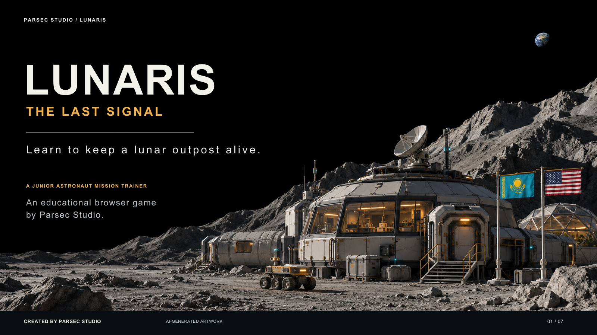

# LUNARIS - Project presentation

**[View PDF](LUNARIS-Demo.pdf) · [Download PDF](https://github.com/isazhannnn/LUNARIS/raw/refs/heads/main/demo/LUNARIS-Demo.pdf) · [Play the live game](https://parsec.kz/lunaris/)**

Seven English slides introduce the project, its learning approach, four playable science expeditions, NASA references and the team. Gameplay captures show the running game; generated environment illustrations are visibly identified. The presentation is included as a public PDF of approximately 5 MB.

**Created by Parsec Studio. Project team: Meiirzhan Issa and Zhasulan Zholdas.**

The [generation prompts](GENERATION_PROMPTS.json) document the fictional concept artwork. Full project details are in the [main README](../README.md).
